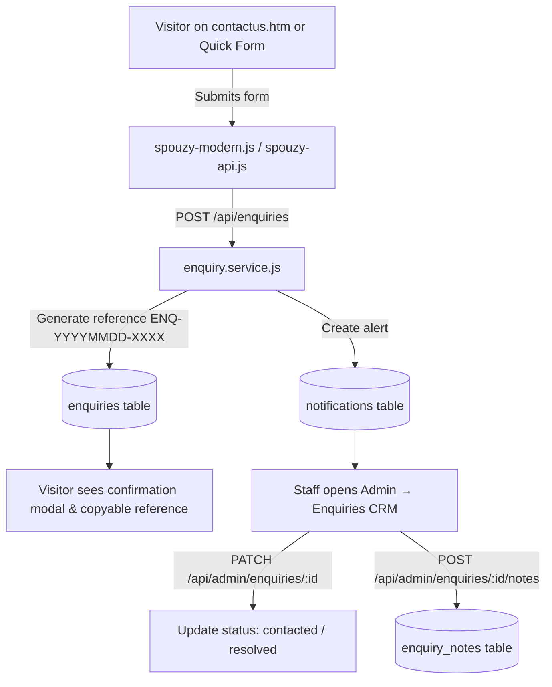
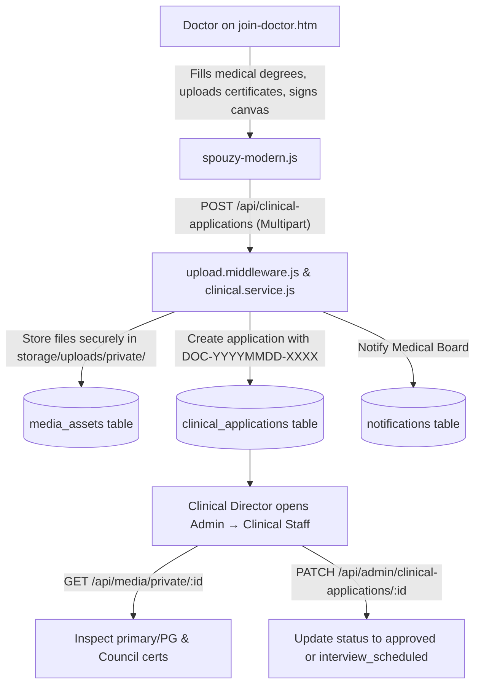
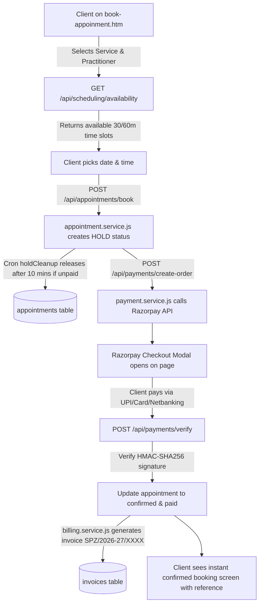
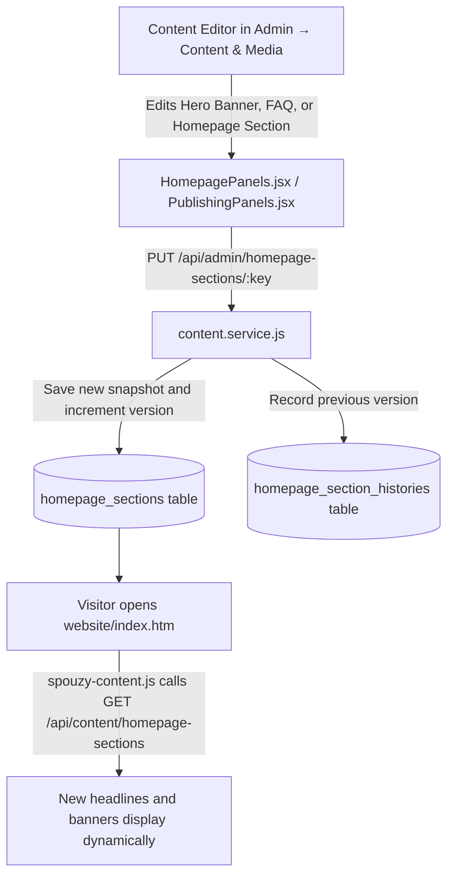

# SPOUZY: Comprehensive Project Documentation & Codebase Map

> **Audience**: Project Owners & Stakeholders (plain English summaries) and Software Engineers (technical architecture, file links, and routing inventories).  
> **Source Workspace**: `D:\DOWNLOADS\spouzynew25`  
> **Documentation Date**: November 2026

---

## 1. Project Overview

### Plain-Language Summary for Project Owners
**SPOUZY** is a specialized clinical healthcare, relationship advisory, and dispute resolution digital platform operated by the **Problem Solver Group (PSG)**. Established with clinical roots dating back to 2004, SPOUZY provides discreet, multi-channel care covering pre-marital counseling, post-marital relationship enrichment, confidential intimate healthcare & medical aesthetics, and amicable separation/divorce mediation.

The platform combines three interconnected systems:
1. **The Public Website**: A high-trust, responsive website featuring educational service guides, interactive relationship wellness tips, clinical credentialing applications, career opportunities, multi-session therapy packages, and a self-service appointment booking engine.
2. **The Client Portal**: A private area where clients register or log in, browse therapy packages, maintain a shopping cart, review their scheduled appointments, view official invoices/bills, and interact with an automated confidential AI assistant.
3. **The Staff Admin Management Console**: A role-restricted single-page application (SPA) where operations staff, clinical directors, and content editors manage client leads, schedule practitioners, review doctor/counsellor applications with certificate validation, publish educational articles, manage promotions, and configure payment gateways.

### User Roles & Capabilities
The system enforces five distinct roles defined in [backend/src/config/permissions.js](backend/src/config/permissions.js):

| Role Slug | Display Label | Target User | Key Capabilities |
| :--- | :--- | :--- | :--- |
| `admin` | **Administrator** | Executive Leadership & System Admins | Full access to all modules: staff user management, role editing, payment gateway configuration, system audit logs, billing profiles, and all clinical/content tools. |
| `operations_staff` | **Operations Staff** | Front Desk & Clinic Coordinators | Manages client enquiries CRM, reviews submitted career applications, monitors appointment bookings, views practitioner calendars, handles customer package orders, and views active offers. |
| `clinical_director` | **Clinical Director** | Chief Medical Officer / Lead Psychologist | Oversees clinical governance: verifies and approves doctor/counsellor onboarding applications (including medical council certificates and qualifications), manages practitioner schedules and time-off blocks, reviews clinical blog posts, and moderates patient stories and FAQs. |
| `content_editor` | **Content Editor** | Marketing & Communications Staff | Edits public website copy, manages hero banners, configures relationship tips, writes and publishes blog articles, manages media asset uploads, reviews submitted FAQs/testimonials, and creates promotional offer cards. |
| `customer` | **Customer** | Clients & Patients | Self-service portal access: books and pays for clinical consultations, buys multi-session packages, manages cart items, views approved billing invoices, tracks appointment statuses, and chats with the confidential automated assistant. |

### Core Client Journeys Available Today
1. **Private Consultation Booking**: Visitors explore clinical specialities, choose an in-person clinic (Mumbai, Pune, Delhi, Bengaluru) or teleconsultation (video/phone), select a qualified practitioner, reserve a live slot (held temporarily for 10 minutes), and complete payment via Razorpay.
2. **Direct Healthcare & Counselling Package Purchases**: Clients browse bundled treatment programs (e.g., pre-marital couples assessments, psychosexual therapy), add them to cart, apply promotional offers, and complete checkout.
3. **Clinical Practitioner Onboarding**: Licensed doctors and certified psychologists apply to join the PSG clinical wing by submitting their educational degrees, state medical council registration numbers, ID proofs, and digital signatures.
4. **General & Discretion Inquiries**: Prospective clients submit confidential inquiries from any page, which route immediately into the staff CRM desk with tracking reference numbers (`ENQ-YYYYMMDD-XXXX`).
5. **Interactive AI Guidance**: Clients open the embedded confidential chat widget to ask questions regarding intimate health, appointment logistics, fees, and privacy protocols.

---

## 2. Public Website and Page Inventory

The public website is served by the Node.js Express server from the [website/](website/) directory using static middleware with extension fallback (`.htm` and `.html`). The canonical entry point is [website/index.htm](website/index.htm).

### Public Routes and Pages

| URL / File Path | Page Purpose | Access Level | Main Actions & Interactions | Implementation Source File |
| :--- | :--- | :--- | :--- | :--- |
| `/` or `/index.htm` | Homepage & Service Directory | Public | Hero banner carousel, animated navbar with logo-teddy flip, service tiles, testimonials carousel presented by pink & blue mascots, live tips widget, quick contact modal, chat assistant trigger | [website/index.htm](website/index.htm) |
| `/book-appoinment.htm` | Consultation Booking Engine | Public / Client | Multi-step booking wizard: service selection, practitioner choice, real-time date/slot availability check, guest or client checkout, Razorpay payment popup | [website/book-appoinment.htm](website/book-appoinment.htm) |
| `/appointment.htm` | Booking Wizard (Legacy Alias) | Public / Client | Mirror of the consultation booking wizard for backward-compatible marketing URLs | [website/appointment.htm](website/appointment.htm) |
| `/packages.htm` | Multi-Session Packages Catalog | Public / Client | Browse therapy bundles, compare session counts and savings, add packages to cart, view active promotional badges | [website/packages.htm](website/packages.htm) |
| `/cart.htm` | Client Shopping Cart & Checkout | Public / Client | Review package quantities, calculate total and offer discounts, proceed to secure checkout | [website/cart.htm](website/cart.htm) |
| `/account.htm` | Customer Account Dashboard | Authenticated Client | View active bookings, order history, package allowances, profile details, and download issued bills | [website/account.htm](website/account.htm) |
| `/register.htm` | Customer Login Portal | Public | Email and password login for registered clients with redirect to pending checkout or account dashboard | [website/register.htm](website/register.htm) |
| `/create-account.htm` | Customer Sign-Up Portal | Public | Registration form (name, email, phone, password) creating customer user records with instant session creation | [website/create-account.htm](website/create-account.htm) |
| `/invoice.htm` | Official Bill & Tax Invoice View | Client or Staff | Printable A4 invoice rendering with financial year number, GST breakdown, QR/payment status, and staff preview watermark | [website/invoice.htm](website/invoice.htm) |
| `/contactus.htm` | Contact & Clinic Locations | Public | Comprehensive inquiry form, clinic addresses (Mumbai, Pune, Delhi, Bengaluru), direct telephone and WhatsApp links | [website/contactus.htm](website/contactus.htm) |
| `/careers.htm` | Careers Desk & Openings | Public | Dynamic job listings fetched from API, role details, resume upload modal, application submission | [website/careers.htm](website/careers.htm) |
| `/join-doctor.htm` | Doctor Credentialing Portal | Medical Practitioners | Multi-step medical application: MBBS/MD details, Medical Council registration, document uploads, digital canvas signature | [website/join-doctor.htm](website/join-doctor.htm) |
| `/join-counsellor.htm` | Counsellor Credentialing Portal | Mental Health Professionals | Multi-step psychology/counselling application: Master's/RCI details, certificate uploads, consultation mode preferences | [website/join-counsellor.htm](website/join-counsellor.htm) |
| `/faq.htm` | Knowledge Base & Ask Question | Public | Categorized accordion FAQs loaded from database; visitor question submission form with consent flags | [website/faq.htm](website/faq.htm) |
| `/blog.htm` | Clinical & Relationship Blog | Public | Article feed, category filtering, reading view with medical disclaimers | [website/blog.htm](website/blog.htm) |
| `/testimonials-policy.htm` | Client Stories & Submissions | Public | Moderated testimonials display; anonymous patient story submission form | [website/testimonials-policy.htm](website/testimonials-policy.htm) |
| `/pre-marriage.htm` | Pre-Marriage Clinical Wing | Public | Service guide on couples compatibility, medical screenings, and communication readiness | [website/pre-marriage.htm](website/pre-marriage.htm) |
| `/post-marriage.htm` | Post-Marriage Therapy | Public | Clinical guidance on intimacy hurdles, conflict resolution, and family integration | [website/post-marriage.htm](website/post-marriage.htm) |
| `/intimate-health.htm` | Intimate Health & Medical Clinic | Public | Information on confidential psychosexual medicine, dysfunctions, and private doctor visits | [website/intimate-health.htm](website/intimate-health.htm) |
| `/intimate-aesthetics-treatment.htm` | Intimate Aesthetics & Dermatology | Public | Clinical dermatology, pelvic floor wellness, and cosmetic intimate procedures | [website/intimate-aesthetics-treatment.htm](website/intimate-aesthetics-treatment.htm) |
| `/divorce-mediation.htm` | Amicable Divorce Mediation | Public | Alternative dispute resolution, child custody frameworks, and financial asset division guidance | [website/divorce-mediation.htm](website/divorce-mediation.htm) |
| `/relationships.htm` | Relationship Advisory | Public | General couples therapy, emotional reconnecting, and infidelity recovery services | [website/relationships.htm](website/relationships.htm) |
| `/counselling.htm` | Individual Counselling Desk | Public | Individual psychological therapy, stress, depression, and personal anxiety consultations | [website/counselling.htm](website/counselling.htm) |
| `/treatment.htm` | Treatment Protocols | Public | Overview of PSG clinical methodology, evidence-based therapies, and medical confidentiality | [website/treatment.htm](website/treatment.htm) |
| `/coaching.htm` | Personal & Couples Coaching | Public | Goal-oriented relationship life coaching and communication workshops | [website/coaching.htm](website/coaching.htm) |
| `/training.htm` | Institutional & Professional Training | Public | Clinical training courses, continuing medical education, and workshop bookings | [website/training.htm](website/training.htm) |
| `/students.htm` | Student & Youth Support | Public | Subsidized, youth-focused sexual wellness and emotional counseling services | [website/students.htm](website/students.htm) |
| `/military-families.htm` | Armed Forces & Veteran Care | Public | Dedicated relationship and separation support for defence forces personnel and families | [website/military-families.htm](website/military-families.htm) |
| `/reconnecting-after-time-apart.htm` | Separation Recovery Desk | Public | Specialized therapy for long-distance couples and partners reuniting after separation | [website/reconnecting-after-time-apart.htm](website/reconnecting-after-time-apart.htm) |
| `/before-a-shared-decision.htm` | Major Decision Counselling | Public | Neutral guided mediation before marriage, IVF, adoption, or relocation | [website/before-a-shared-decision.htm](website/before-a-shared-decision.htm) |
| `/corporate-kamasutra.htm` | Corporate Executive Intimacy | Public | Stress reduction, burnout mitigation, and intimacy balance programs for corporate executives | [website/corporate-kamasutra.htm](website/corporate-kamasutra.htm) |
| `/gen-z-kama-sutra.htm` | Modern Intimacy Literacy | Public | Contemporary educational relationship content for young adults | [website/gen-z-kama-sutra.htm](website/gen-z-kama-sutra.htm) |
| `/harassment-support.htm` | Trauma & Harassment Support | Public | Discreet psychological assistance, legal mediation guidance, and crisis recovery | [website/harassment-support.htm](website/harassment-support.htm) |
| `/about-us.htm` | About SPOUZY & PSG | Public | Organizational background, multi-disciplinary approach, clinical ethics | [website/about-us.htm](website/about-us.htm) |
| `/about-profile.htm` | Clinical Leadership Profile | Public | Detailed professional profile of the founder and principal consultant | [website/about-profile.htm](website/about-profile.htm) |
| `/mission.htm` | Mission Statement | Public | PSG core philosophy and commitment to family preservation | [website/mission.htm](website/mission.htm) |
| `/vision.htm` | Vision & Future Roadmap | Public | Long-term strategy for integrated sexual and marital health in India | [website/vision.htm](website/vision.htm) |
| `/mission-vision.htm` | Combined Mission & Vision | Public | Consolidated overview of organisational goals | [website/mission-vision.htm](website/mission-vision.htm) |
| `/team.htm` | Clinical Faculty & Advisors | Public | Directory of consulting doctors, psychologists, advocates, and sexologists | [website/team.htm](website/team.htm) |
| `/webinar-ebook.htm` | Webinars & E-Books | Public | Downloadable literature, guided relationship workbooks, webinar registrations | [website/webinar-ebook.htm](website/webinar-ebook.htm) |
| `/solution-guarantee.htm` | Clinical Care Guarantee | Public | Quality assurance, practitioner standards, client satisfaction commitments | [website/solution-guarantee.htm](website/solution-guarantee.htm) |
| `/privacy-policy.htm` | Privacy Policy | Public | Data collection standards, strict clinical non-disclosure, DPDP compliance | [website/privacy-policy.htm](website/privacy-policy.htm) |
| `/terms.htm` | Terms of Service | Public | User terms, intellectual property, medical disclaimer, service boundaries | [website/terms.htm](website/terms.htm) |
| `/confidentiality.htm` | Non-Disclosure & Confidentiality | Public | Doctor-patient privilege guarantee and data silo architecture | [website/confidentiality.htm](website/confidentiality.htm) |
| `/informed-consent.htm` | Informed Medical Consent | Public | Legal consent terms for therapy, teleconsultation, and minor protection | [website/informed-consent.htm](website/informed-consent.htm) |
| `/teleconsultation-policy.htm` | Telemedicine Guidelines | Public | Technical, connectivity, and privacy prerequisites for remote video calls | [website/teleconsultation-policy.htm](website/teleconsultation-policy.htm) |
| `/payment-policy.htm` | Payment Terms & Gateways | Public | Disclosures on transaction processing, PCI-DSS compliance, fee structure | [website/payment-policy.htm](website/payment-policy.htm) |
| `/refund-policy.htm` | Cancellation & Refund Policy | Public | Slot rescheduling windows, refund eligibility timelines, processing terms | [website/refund-policy.htm](website/refund-policy.htm) |
| `/delivery-policy.htm` | Service Delivery Timelines | Public | Teleconsultation link dispatch timelines and package activation policies | [website/delivery-policy.htm](website/delivery-policy.htm) |
| `/cookie-policy.htm` | Cookie Usage Policy | Public | Details on session cookies, security tokens, and analytics cookies | [website/cookie-policy.htm](website/cookie-policy.htm) |
| `/grievance-redressal.htm` | Grievance Redressal Mechanism | Public | Formal escalation matrix, Grievance Officer contacts, resolution SLA | [website/grievance-redressal.htm](website/grievance-redressal.htm) |
| `/under-construction.htm` | Feature In Progress | Public | Placeholder notice for upcoming features | [website/under-construction.htm](website/under-construction.htm) |

### Homepage Sections vs Standalone Pages
The homepage ([website/index.htm](website/index.htm)) is an integrated portal that pulls dynamic content from the database via [website/js/spouzy-content.js](website/js/spouzy-content.js) while maintaining fallback HTML:
- **Hero Carousel**: Loaded dynamically from `GET /api/content/hero-banners`, showing headline, tag eyebrow, call to action, and background image.
- **Mascot Testimonial Section**: Headed *"Stories of Recovery, Growth, and Renewed Hope"*, featuring a 3-column layout with the stationary **Pink Teddy** on the left ([website/image/Pink teddy presenting a story.png](website/image/Pink%20teddy%20presenting%20a%20story.png)) and the **Brown Teddy in Blue** on the right ([website/image/Teddy bear cutout in blue stories.png](website/image/Teddy%20bear%20cutout%20in%20blue%20stories.png)) framing the sliding testimonial track.
- **Daily Relationship Tip Widget**: Fetched via `GET /api/content/tips/today`, displaying practical relationship tips that rotate on a timer.
- **Service Modules Grid**: Direct entry points to specialized service sub-pages.
- **FAQ Preview Accordion**: Fetched via `GET /api/content/faqs`.

---

## 3. Admin Panel

### Entry URL and Access Enforcement
- **Entry URL**: `/admin` (compiled React application served from `admin/dist/` via Express static fallback) or `http://localhost:5173/` during Vite development.
- **Router**: React Router 6 with `HashRouter` (`/#/login`, `/#/enquiries`, etc.).
- **Authentication**: Email/password authentication handled by `POST /api/auth/login`. On success, the server issues an HTTP-only session cookie (`spouzy_session`) and a CSRF token cookie (`spouzy_csrf`).
- **Route Guarding**: Enforced on the client via [admin/src/components/PermissionRoute.jsx](admin/src/components/PermissionRoute.jsx) and on the backend via [backend/src/middlewares/rbac.middleware.js](backend/src/middlewares/rbac.middleware.js) (`requirePermission`).
- **CSRF Defense**: All mutating requests (`POST`, `PUT`, `PATCH`, `DELETE`) enforce matching `X-CSRF-Token` headers via [backend/src/middlewares/csrf.middleware.js](backend/src/middlewares/csrf.middleware.js).

### Verified Admin Screens Inventory

| Hash Route | Permitted Roles / Permissions | View & Edit Capabilities | Data Destination & Storage | Implementation File |
| :--- | :--- | :--- | :--- | :--- |
| `/#/` | `admin`, `operations_staff`, `clinical_director` (`enquiries:view`, `clinical_apps:view`, `appointments:view`) | High-level metrics (total inquiries, pending applications, today's appointments), today's schedule, quick actions, analytics trends | Reads `GET /api/admin/dashboard/overview` & `GET /api/admin/dashboard/stats` | [admin/src/pages/DashboardPage.jsx](admin/src/pages/DashboardPage.jsx) |
| `/#/content-dashboard` | `content_editor`, `admin` (`content:view`, `blogs:view`, `moderation:view`) | Content summary counts: active hero banners, tips, published blogs, FAQs, pending questions, pending stories | Reads `GET /api/admin/dashboard/content-summary` | [admin/src/pages/ContentDashboardPage.jsx](admin/src/pages/ContentDashboardPage.jsx) |
| `/#/enquiries` | `enquiries:view`, `enquiries:edit`, `enquiries:export` | Search and filter inquiries; update inquiry status (`new`, `contacted`, `in_progress`, `resolved`, `closed`); view contact details; add internal timeline notes; export CSV | Reads/writes `enquiries` and `enquiry_notes` tables via `GET/PATCH /api/admin/enquiries` and `POST /api/admin/enquiries/:id/notes` | [admin/src/pages/EnquiriesPage.jsx](admin/src/pages/EnquiriesPage.jsx) |
| `/#/clinical` | `clinical_apps:view`, `clinical_apps:edit`, `clinical_apps:export`, `clinical_apps:download_docs` | Filter doctor & counsellor applications; review education, medical council registrations, and signed declarations; download certificates; update application status (`under_review`, `approved`, `rejected`) | Reads/writes `clinical_applications` and `media_assets` via `GET/PATCH /api/admin/clinical-applications` and `GET /api/media/private/:id` | [admin/src/pages/ClinicalPage.jsx](admin/src/pages/ClinicalPage.jsx) |
| `/#/careers` | `careers:view`, `careers:edit`, `careers:download` | Post, edit, and deactivate job openings; review candidate applications, view qualifications, download resumes, update hiring status | Reads/writes `career_openings`, `career_applications`, and `media_assets` via `/api/admin/career-openings` and `/api/admin/career-applications` | [admin/src/pages/CareersPage.jsx](admin/src/pages/CareersPage.jsx) |
| `/#/appointments` | `appointments:view`, `appointments:edit`, `appointments:reschedule`, `scheduling:view`, `scheduling:edit` | Master booking calendar; view client booking details; update status (`confirmed`, `completed`, `cancelled`, `no_show`); reschedule appointment time; manage practitioner schedules and temporary time-off blocks | Reads/writes `appointments`, `appointment_status_histories`, `practitioners`, `weekly_schedules`, `blocked_intervals` | [admin/src/pages/AppointmentsPage.jsx](admin/src/pages/AppointmentsPage.jsx) |
| `/#/chats` | `enquiries:view` | Monitor visitor conversations with AI assistant; view message transcripts, customer emails, intent matches; inspect unanswered questions | Reads `chat_conversations` and `chat_messages` tables via `GET /api/admin/chats` and `GET /api/admin/chat-unanswered` | [admin/src/pages/ChatsPage.jsx](admin/src/pages/ChatsPage.jsx) |
| `/#/shop` | `orders:view`, `packages:view`, `offers:view`, `orders:edit`, `packages:edit`, `offers:edit` | 4 Tabs: 1) **Packages**: create/edit bundled services; 2) **Offers**: create popup offer banners; 3) **Orders**: manage client package orders; 4) **Bills**: issue and send official invoices | Reads/writes `packages`, `offers`, `package_orders`, `invoices`, `billing_profiles` via `/api/admin/packages`, `/api/admin/offers`, `/api/admin/invoices` | [admin/src/pages/ShopPage.jsx](admin/src/pages/ShopPage.jsx) |
| `/#/content` | `content:view`, `content:edit`, `content:delete`, `blogs:view`, `blogs:edit`, `moderation:view`, `media:view` | 3 Tabs: 1) **Homepage Panels**: hero banners, tips, homepage section text with rollback history; 2) **Publishing Panels**: blog editor, FAQ manager, Q&A moderation, story moderation; 3) **Media Library**: file manager | Reads/writes `hero_banners`, `tips`, `homepage_sections`, `homepage_section_histories`, `blog_articles`, `faqs`, `visitor_questions`, `visitor_stories`, `media_assets` | [admin/src/pages/ContentPage.jsx](admin/src/pages/ContentPage.jsx) |
| `/#/settings` | `settings:content`, `settings:gateway` | Site settings (helpline numbers, WhatsApp, announcement bar, custom cursors, chat widget toggles) and Razorpay gateway credentials (encrypted key/secret, test/live mode) | Reads/writes `site_settings` and `payment_gateway_configs` via `/api/admin/settings` and `/api/admin/gateway-config` | [admin/src/pages/SettingsPage.jsx](admin/src/pages/SettingsPage.jsx) |
| `/#/users` | `admin` (or `users:manage`) | Staff accounts list; add/deactivate staff; reset passwords; inspect roles & assign custom permission overrides; audit logs viewer | Reads/writes `users`, `roles`, and `audit_logs` via `GET/POST/PUT /api/admin/users`, `GET /api/admin/roles`, `GET /api/admin/audit-logs` | [admin/src/pages/UsersAuditPage.jsx](admin/src/pages/UsersAuditPage.jsx) |
| `/#/notifications` | All staff roles | Notification center with category filtering (bookings, enquiries, payments, applications, orders); mark read/unread | Reads/writes `notifications` and `notification_reads` via `GET /api/admin/notifications` and `POST /api/admin/notifications/read` | [admin/src/pages/NotificationsPage.jsx](admin/src/pages/NotificationsPage.jsx) |
| `/#/guide` | All staff roles | Interactive operational handbook and documentation for staff workflows | Client-side guide constants rendered from [admin/src/constants/guides.js](admin/src/constants/guides.js) | [admin/src/pages/GuidePage.jsx](admin/src/pages/GuidePage.jsx) |

---

## 4. Backend, APIs and Data Storage

### Architecture
- **Framework**: Node.js v18+ with Express 4.21.2.
- **ORM & Database Driver**: Sequelize 6.37.5 with `mysql2` 3.12.0 targeting MySQL 8.0+.
- **Security & Headers**: Helmet 8.0.0, CORS 2.8.5, cookie-parser 1.4.7, express-rate-limit 7.5.0, CSRF double-submit token checking, input sanitization via `sanitize-html` 2.14.0.
- **Storage Subsystem**: Multer 1.4.5 handling multipart form data. Files are routed into:
  - `backend/storage/uploads/public/` (served at `/media/public/*` for public images).
  - `backend/storage/uploads/private/` (served only via authenticated staff routes at `/api/media/private/:id` for medical certificates and candidate resumes).
- **Scheduled Background Jobs**: `node-cron` 3.0.3 running in [backend/src/server.js](backend/src/server.js) executing [backend/src/jobs/holdCleanup.job.js](backend/src/jobs/holdCleanup.job.js) every 2 minutes to release expired appointment reservation holds.

### Core API Endpoints Inventory

| Method & Route | Purpose | Access Control | Data Source / Destination | Implementation File |
| :--- | :--- | :--- | :--- | :--- |
| `GET /api/health` | Service health check & CSRF cookie initiation | Public | Memory / System time | [backend/src/routes/index.js](backend/src/routes/index.js) |
| `POST /api/auth/login` | Staff admin login | Public (Rate-limited) | `users`, `roles`, `sessions` | [backend/src/routes/auth.routes.js](backend/src/routes/auth.routes.js) |
| `GET /api/auth/me` | Current authenticated session profile & permissions | Authenticated Staff / Customer | `users`, `roles` | [backend/src/routes/auth.routes.js](backend/src/routes/auth.routes.js) |
| `POST /api/auth/logout` | Invalidate current session | Authenticated | `sessions` (deleted) | [backend/src/routes/auth.routes.js](backend/src/routes/auth.routes.js) |
| `POST /api/auth/change-password` | Update account password | Authenticated | `users` (`password_hash`) | [backend/src/routes/auth.routes.js](backend/src/routes/auth.routes.js) |
| `POST /api/auth/customer/register` | Customer sign-up | Public (Rate-limited) | `users` (`role_id` = customer) | [backend/src/routes/auth.routes.js](backend/src/routes/auth.routes.js) |
| `POST /api/auth/customer/login` | Customer login | Public (Rate-limited) | `users`, `sessions` | [backend/src/routes/auth.routes.js](backend/src/routes/auth.routes.js) |
| `POST /api/enquiries` | Submit client inquiry | Public (Rate-limited) | `enquiries`, `notifications` | [backend/src/routes/enquiry.routes.js](backend/src/routes/enquiry.routes.js) |
| `POST /api/clinical-applications` | Submit doctor/counsellor onboarding form | Public (Rate-limited, Multipart) | `clinical_applications`, `media_assets` | [backend/src/routes/clinical.routes.js](backend/src/routes/clinical.routes.js) |
| `GET /api/careers/openings` | List active job openings | Public | `career_openings` | [backend/src/routes/career.routes.js](backend/src/routes/career.routes.js) |
| `POST /api/careers/applications` | Submit job application with resume | Public (Rate-limited, Multipart) | `career_applications`, `media_assets` | [backend/src/routes/career.routes.js](backend/src/routes/career.routes.js) |
| `GET /api/scheduling/config` | Get booking days in advance & clinic locations | Public | Memory / Environment | [backend/src/routes/scheduling.routes.js](backend/src/routes/scheduling.routes.js) |
| `GET /api/scheduling/services` | List active clinical services and prices | Public | `services` | [backend/src/routes/scheduling.routes.js](backend/src/routes/scheduling.routes.js) |
| `GET /api/scheduling/practitioners` | List active doctors & counsellors | Public | `practitioners` | [backend/src/routes/scheduling.routes.js](backend/src/routes/scheduling.routes.js) |
| `GET /api/scheduling/availability` | Calculate available booking time slots | Public | `weekly_schedules`, `blocked_intervals`, `appointments` | [backend/src/routes/scheduling.routes.js](backend/src/routes/scheduling.routes.js) |
| `POST /api/appointments/book` | Place appointment hold / book consultation | Public (Rate-limited) | `appointments`, `appointment_status_histories` | [backend/src/routes/appointment.routes.js](backend/src/routes/appointment.routes.js) |
| `GET /api/appointments/lookup/:ref` | Public lookup of booking reference details | Public (Rate-limited) | `appointments` | [backend/src/routes/appointment.routes.js](backend/src/routes/appointment.routes.js) |
| `GET /api/content/hero-banners` | Active homepage hero banner slides | Public | `hero_banners` | [backend/src/routes/content.routes.js](backend/src/routes/content.routes.js) |
| `GET /api/content/tips/today` | Today's active relationship tips | Public | `tips` | [backend/src/routes/content.routes.js](backend/src/routes/content.routes.js) |
| `GET /api/content/blogs` | Published blog articles | Public | `blog_articles`, `blog_categories` | [backend/src/routes/content.routes.js](backend/src/routes/content.routes.js) |
| `GET /api/content/faqs` | Published FAQ list | Public | `faqs` | [backend/src/routes/content.routes.js](backend/src/routes/content.routes.js) |
| `POST /api/content/faqs/ask` | Submit visitor question for moderation | Public (Rate-limited) | `visitor_questions`, `notifications` | [backend/src/routes/content.routes.js](backend/src/routes/content.routes.js) |
| `GET /api/content/stories` | Approved client testimonials | Public | `visitor_stories` | [backend/src/routes/content.routes.js](backend/src/routes/content.routes.js) |
| `POST /api/content/stories/submit` | Submit patient recovery story | Public (Rate-limited) | `visitor_stories`, `notifications` | [backend/src/routes/content.routes.js](backend/src/routes/content.routes.js) |
| `GET /api/content/settings` | Public site parameters (phones, WA, announcement) | Public | `site_settings` | [backend/src/routes/content.routes.js](backend/src/routes/content.routes.js) |
| `GET /api/packages` | Available therapy & counselling packages | Public | `packages` | [backend/src/routes/shop.routes.js](backend/src/routes/shop.routes.js) |
| `GET /api/offers` | Active promotional cards and popup offers | Public | `offers` | [backend/src/routes/offer.routes.js](backend/src/routes/offer.routes.js) |
| `GET/POST /api/customer/cart` | View and modify customer shopping cart | Customer Auth | `cart_items`, `packages` | [backend/src/routes/customer.routes.js](backend/src/routes/customer.routes.js) |
| `POST /api/customer/checkout` | Create package order from cart | Customer Auth | `package_orders`, `cart_items` (cleared) | [backend/src/routes/customer.routes.js](backend/src/routes/customer.routes.js) |
| `GET /api/customer/orders` | Customer's order history | Customer Auth | `package_orders` | [backend/src/routes/customer.routes.js](backend/src/routes/customer.routes.js) |
| `GET /api/customer/invoices` | List invoices issued to customer | Customer Auth | `invoices` (status = `sent`) | [backend/src/routes/customer.routes.js](backend/src/routes/customer.routes.js) |
| `POST /api/customer/chat/start` | Initialize AI assistant conversation session | Customer Auth (or Guest flow) | `chat_conversations` | [backend/src/routes/customer.routes.js](backend/src/routes/customer.routes.js) |
| `POST /api/customer/chat/message` | Send message to AI assistant | Customer Auth | `chat_messages`, `chat_conversations` | [backend/src/routes/customer.routes.js](backend/src/routes/customer.routes.js) |
| `POST /api/payments/create-order` | Create Razorpay payment order for booking/cart | Public / Customer (Rate-limited) | `payment_orders`, Razorpay Gateway API | [backend/src/routes/payment.routes.js](backend/src/routes/payment.routes.js) |
| `POST /api/payments/verify` | Verify Razorpay HMAC signature & mark paid | Public / Customer (Rate-limited) | `payment_orders`, `payment_transactions`, `invoices`, `appointments` | [backend/src/routes/payment.routes.js](backend/src/routes/payment.routes.js) |
| `POST /api/payments/webhook` | Asynchronous Razorpay webhook processing | Razorpay Signature Verified | `payment_orders`, `payment_transactions`, `invoices` | [backend/src/routes/payment.routes.js](backend/src/routes/payment.routes.js) |
| `GET /api/media/private/:id` | Secure streaming of private candidate documents | Staff Auth (`clinical_apps` or `careers`) | `media_assets`, local private storage | [backend/src/routes/media.routes.js](backend/src/routes/media.routes.js) |
| `/api/admin/*` | All staff administration endpoints | Staff Auth + RBAC | Database & Storage | [backend/src/routes/admin.routes.js](backend/src/routes/admin.routes.js) |

### Database Tables & Schema
The database is managed via Sequelize migrations located in [backend/src/migrations/](backend/src/migrations/):

```
1. roles                        23. career_openings
2. users                        24. career_applications
3. sessions                     25. payment_gateway_configs
4. password_reset_tokens        26. payment_orders
5. media_assets                 27. payment_transactions
6. hero_banners                 28. packages
7. tips                         29. cart_items
8. blog_categories              30. package_orders
9. blog_articles                31. offers
10. faqs                        32. invoices
11. visitor_questions           33. billing_profiles
12. visitor_stories             34. customer_billing_details
13. services                    35. notifications
14. practitioners               36. notification_reads
15. weekly_schedules            37. customer_activities
16. schedule_overrides          38. chat_conversations
17. blocked_intervals           39. chat_messages
18. appointments                40. site_settings
19. appointment_status_histories 41. audit_logs
20. enquiries                   42. homepage_sections
21. enquiry_notes               43. homepage_section_histories
22. clinical_applications
```

---

## 5. End-to-End Feature Flows

### Flow 1: Lead Inquiry Submission & CRM Processing


1. **User Action**: A prospective client fills out their name, contact info, preferred clinic (e.g. Mumbai), and message on [website/contactus.htm](website/contactus.htm) or the homepage drawer.
2. **Client Handling**: [website/js/spouzy-modern.js](website/js/spouzy-modern.js) validates inputs and calls `SpouzyApi.submitEnquiry` in [website/js/spouzy-api.js](website/js/spouzy-api.js).
3. **Backend Processing**: `POST /api/enquiries` is handled by [backend/src/services/enquiry.service.js](backend/src/services/enquiry.service.js), which stores the record with a unique reference number (`ENQ-YYYYMMDD-XXXX`) and creates an in-app notification.
4. **Outcome**: The visitor sees a reassuring confirmation modal with their tracking reference. Staff view the record in [admin/src/pages/EnquiriesPage.jsx](admin/src/pages/EnquiriesPage.jsx), add internal notes, and can export leads to CSV.

---

### Flow 2: Doctor Credentialing & Medical Onboarding


1. **User Action**: A medical doctor visits [website/join-doctor.htm](website/join-doctor.htm), fills out registration years, Medical Council jurisdiction, hospital affiliations, uploads photo and degree certificates, and signs on the HTML5 canvas.
2. **Client Handling**: [website/js/spouzy-modern.js](website/js/spouzy-modern.js) converts the signature canvas to a PNG blob, packages certificates into `FormData`, and posts to `SpouzyApi.submitClinical`.
3. **Backend Processing**: Handled by [backend/src/services/clinical.service.js](backend/src/services/clinical.service.js). Certificates are written into private non-public storage (`backend/storage/uploads/private/`) and cataloged in `media_assets`. The application is assigned a reference like `DOC-20261121-AB12`.
4. **Outcome**: The doctor receives a formal submission screen. The Clinical Director logs into [admin/src/pages/ClinicalPage.jsx](admin/src/pages/ClinicalPage.jsx), securely reviews certificates, validates state council registrations, and updates the application status.

---

### Flow 3: Appointment Booking, Slot Holding & Payment


1. **User Action**: A client visits [website/book-appoinment.htm](website/book-appoinment.htm), selects *Intimate Healthcare*, picks a doctor, views open calendar dates, and selects a 30-minute video slot.
2. **Live Availability Check**: [website/js/spouzy-api.js](website/js/spouzy-api.js) queries `GET /api/scheduling/availability`. The server calculates available slots by cross-referencing practitioner schedules, existing appointments, and blocked intervals.
3. **Slot Reservation**: `POST /api/appointments/book` creates an `Appointment` in `hold` status with a 10-minute expiry (`hold_expires_at`).
4. **Payment Processing**: If Razorpay is enabled, `POST /api/payments/create-order` creates a Razorpay gateway order. The Razorpay modal opens in the client's browser.
5. **Verification & Invoice Generation**: On payment success, `POST /api/payments/verify` validates the HMAC-SHA256 signature. The appointment updates to `confirmed` with `payment_status = 'paid'`, and [backend/src/services/billing.service.js](backend/src/services/billing.service.js) automatically writes an `Invoice` record.

---

### Flow 4: Content Management & Instant Website Publishing


1. **User Action**: A Content Editor navigates to `/#/content` in the admin panel and updates the hero banner headline or homepage section copy.
2. **Backend Processing**: Handled by [backend/src/services/content.service.js](backend/src/services/content.service.js). The previous state is archived into `homepage_section_histories`, allowing one-click rollbacks if needed.
3. **Outcome**: When any visitor loads [website/index.htm](website/index.htm), [website/js/spouzy-content.js](website/js/spouzy-content.js) pulls the updated JSON payload via `GET /api/content/homepage-sections` and updates the DOM in real time.

---

## 6. Technology, Integrations and Configuration

### Technology Stack & Declared Versions

| Area | Technologies & Libraries | Declared Versions |
| :--- | :--- | :--- |
| **Frontend (Public)** | HTML5, CSS3, Vanilla JavaScript (ES6+), jQuery, Owl Carousel, Bootstrap grid utilities | `jquery` 3.x, modern CSS variables |
| **Frontend (Admin)** | React, React Router DOM, Vite | `react` ^18.3.1, `react-router-dom` ^6.28.0, `vite` ^6.0.7 |
| **Backend API** | Node.js, Express, Sequelize ORM, MySQL2 | `express` ^4.21.2, `sequelize` ^6.37.5, `mysql2` ^3.12.0 |
| **Security & Cryptography** | Helmet, CORS, Cookie-Parser, BcryptJS, Sanitize-HTML, UUID | `helmet` ^8.0.0, `bcryptjs` ^2.4.3, `sanitize-html` ^2.14.0, `uuid` ^11.0.5 |
| **Task Scheduling** | Node-cron (in-process scheduler) | `node-cron` ^3.0.3 |
| **File Upload Handling** | Multer | `multer` ^1.4.5-lts.1 |
| **Payment Gateway** | Razorpay Node SDK & Razorpay Checkout.js | `razorpay` ^2.9.5 |

### Third-Party Integrations
1. **Razorpay Payment Gateway**:
   - Purpose: Processing client payments for appointments and therapy packages.
   - Invocation: Backend client initialized in [backend/src/services/payment.service.js](backend/src/services/payment.service.js); frontend script dynamically injected by [website/js/spouzy-api.js](website/js/spouzy-api.js). Webhook listener verified at `POST /api/payments/webhook`.
2. **WhatsApp Direct Chat Linkage**:
   - Purpose: Immediate client hand-off to WhatsApp care agents for high-urgency counseling inquiries.
   - Invocation: Configured via `site_settings.whatsapp_number` and invoked in [website/js/spouzy-content.js](website/js/spouzy-content.js) and [website/js/spouzy-chat.js](website/js/spouzy-chat.js) using the `https://wa.me/<number>` protocol.

### Environment Variables Inventory
Configuration is loaded via [backend/src/config/environment.js](backend/src/config/environment.js) from `backend/.env`.

> [!IMPORTANT]
> Never commit actual credentials, database passwords, or secret keys to source control.

| Variable Name | Required? | Purpose & Description |
| :--- | :--- | :--- |
| `NODE_ENV` | Optional | Environment mode: `development`, `production`, or `test`. Defaults to `development`. |
| `PORT` | Optional | HTTP port for Express server. Defaults to `5000`. |
| `DB_HOST` | **Required** | MySQL server host (e.g. `127.0.0.1` or `localhost`). |
| `DB_PORT` | Optional | MySQL server port. Defaults to `3306`. |
| `DB_NAME` | **Required** | Main database name (e.g. `spouzy_dev` or `cpaneluser_spouzy_prod`). |
| `DB_USER` | **Required** | Database connection username. |
| `DB_PASSWORD` | **Required** | Database connection password. |
| `DB_NAME_TEST` | Optional | Database name used when running automated tests (`npm test`). Defaults to `spouzy_test`. |
| `PUBLIC_URL` | Optional | Canonical public URL used for absolute link generation and CORS matching. |
| `ALLOWED_ORIGINS` | Optional | Comma-separated list of origins allowed to make CORS cross-origin requests. |
| `SESSION_SECRET` | **Required** | Cryptographic secret used for hashing session tokens. Enforced at 32+ characters in production. |
| `CSRF_SECRET` | **Required** | Secret key used for double-submit cookie CSRF validation tokens. |
| `ENCRYPTION_KEY` | **Required** | Exactly 64-hex-character (256-bit) key used for AES-256-GCM encryption of payment gateway secrets at rest. |
| `STORAGE_PATH` | Optional | Base path on disk for file uploads. Defaults to `./storage`. |
| `RAZORPAY_KEY_ID` | Optional | Fallback Razorpay test Key ID (overridable via Admin Settings). |
| `RAZORPAY_KEY_SECRET` | Optional | Fallback Razorpay test Key Secret. |
| `RAZORPAY_WEBHOOK_SECRET`| Optional | Secret used to verify incoming Razorpay webhook signatures. |
| `SPOUZY_WHATSAPP_NUMBER` | Optional | Fallback customer WhatsApp support number. |
| `SPOUZY_SUPPORT_EMAIL` | Optional | Fallback customer support email address. |
| `TRUST_PROXY` | Optional | Proxy hop count for reverse proxy setups (cPanel/Passenger/Nginx). |

---

## 7. Repository Map and Local Setup

### Repository Directory Map
```
spouzynew25/
├── package.json              # Root npm workspaces manifest (backend, admin)
├── package-lock.json         # Pinned dependency lockfile
├── ABOUT_PROJECT.md          # Comprehensive architecture & project documentation
├── admin/                    # Admin Panel SPA Workspace (React + Vite)
│   ├── index.html            # Vite entry HTML
│   ├── vite.config.js        # Vite build & dev proxy configuration
│   ├── package.json          # Admin package dependencies
│   ├── dist/                 # Pre-built production distribution
│   └── src/
│       ├── App.jsx           # Master route declarations & permission guards
│       ├── main.jsx          # React DOM root entry
│       ├── components/       # Layout, Modals, Panels, ErrorBoundary, Permissions
│       ├── context/          # AuthContext (sessions, permissions, role normalization)
│       ├── pages/            # 13 Admin view pages (Dashboard, CRM, Clinical, Content, Shop...)
│       └── services/         # API fetch wrappers and auth adapters
├── backend/                  # Backend API Server Workspace (Node.js + Express)
│   ├── package.json          # Backend package dependencies
│   ├── .env.example          # Template for required environment variables
│   ├── storage/              # Uploaded files storage (public and private subdirectories)
│   ├── tests/                # Automated API and permission test suites
│   └── src/
│       ├── app.js            # Express app configuration, middlewares, and routes mount
│       ├── server.js         # HTTP server listener, DB connection, and cron scheduler
│       ├── config/           # Database, environment, security, permissions, time config
│       ├── jobs/             # Scheduled background tasks (expired hold cleanup)
│       ├── middlewares/      # Auth, RBAC, CSRF, error handling, rate limiting, multer
│       ├── migrations/       # 8 sequential database schema migrations
│       ├── models/           # Sequelize model definitions and relational associations
│       ├── routes/           # Express router endpoints
│       ├── scripts/          # Database setup, migrations, seeders, and dev user scripts
│       ├── seeders/          # Production content and manifest seed data
│       └── services/         # Business logic layer for all domains
├── website/                  # Public Website Static Assets & Templates
│   ├── index.htm             # Primary canonical public homepage
│   ├── index.html            # Public homepage alternate/preview
│   ├── *.htm                 # 52 standalone service guides, policies, and interactive pages
│   ├── css/                  # Modern styles (spouzy-modern.css, animations, menu)
│   ├── js/                   # Public interactive scripts (spouzy-api.js, content, chat, shop)
│   └── image/                # Branding assets, mascots, banners, and cursors
├── docs/                     # Supplemental operations documentation
│   ├── SETUP.md              # Local development setup guide
│   ├── CPANEL-DEPLOYMENT.md  # Production cPanel deployment instructions
│   ├── API.md                # REST API endpoint reference
│   └── INTEGRATION-MAP.md    # System component mapping
└── scratch/                  # Development test scripts and backup artifacts
```

### Local Setup & Development Commands

All commands run using standard `npm` from the repository root:

| Command | Purpose | Verified in Audit? |
| :--- | :--- | :--- |
| `npm install` | Install all dependencies across root, backend, and admin workspaces | **Verified** (installed in repo) |
| `npm run dev` | Start backend server with nodemon/node on `http://localhost:5000` | **Verified** (server running & tested on port 5000) |
| `npm run dev:admin` | Start Vite dev server for Admin SPA on `http://localhost:5173` | **Verified** (Vite config present) |
| `npm run build:admin` | Compile production build of Admin React SPA into `admin/dist/` | **Verified** (build files present in `admin/dist/`) |
| `npm run db:setup` | Complete idempotent database initialization (create, migrate, seed) | **Verified** (source checked in `backend/src/scripts/db-setup.js`) |
| `npm run db:migrate` | Execute pending database schema migrations | **Verified** |
| `npm run db:seed` | Seed default roles, banners, tips, services, and site settings | **Verified** |
| `npm run admin:create` | Interactive CLI script to create initial super-administrator | **Verified** |
| `npm run seed:dev-users` | Generate random test accounts for staff roles with one-time passwords | **Verified** |
| `npm test` | Run complete backend automated test suite (`run-all-tests.js`) | **Verified** |

---

## 8. Implementation Status and Unknowns

### Verified as End-to-End Functional
- **Client Lead Inquiries**: Public submission on [website/contactus.htm](website/contactus.htm) → validation → MySQL database storage → real-time staff notification → staff CRM management in [admin/src/pages/EnquiriesPage.jsx](admin/src/pages/EnquiriesPage.jsx) → CSV export.
- **Clinical & Career Onboarding**: Multi-part document upload and digital canvas signature → private filesystem storage → staff credentialing desk with secure certificate viewing in [admin/src/pages/ClinicalPage.jsx](admin/src/pages/ClinicalPage.jsx).
- **Appointment Reservation & Calendar Engine**: Real-time slot availability check → 10-minute temporary hold → cron cleanup job ([backend/src/jobs/holdCleanup.job.js](backend/src/jobs/holdCleanup.job.js)) releasing expired holds.
- **Role-Based Access Control (RBAC)**: Strict permission checking across 5 roles, verified both at React route guards and backend API endpoints with normalized permission slugs.
- **Content Management System (CMS)**: Staff updating banners, tips, FAQs, and homepage text in admin → instantaneous dynamic rendering on public pages via [website/js/spouzy-content.js](website/js/spouzy-content.js).
- **Automated Bill & Invoice Generation**: Automatic generation of sequential financial year invoices (`SPZ/2026-27/XXXX`) on payment with A4 printable view at [website/invoice.htm](website/invoice.htm).
- **Interactive Mascot Homepage Presentation**: Pink and blue teddy mascots presenting the testimonial card across desktop, tablet, and mobile breakpoints without layout shift or horizontal scroll.

### Partial / Environmental Dependencies
- **Live Razorpay Payment Processing**:
  - *Current Status*: Fully wired in code (order creation, signature validation, webhook handling). In local development or fresh deployments where live gateway keys have not been configured, the checkout gracefully displays *"Online payment coming soon"* and marks appointment reservations as unpaid/pending.
  - *Live Verification Requirement*: Requires real Razorpay merchant API keys entered into Admin → Settings.
- **Outbound Email & SMS Dispatch**:
  - *Current Status*: When an inquiry or booking is received, alerts are written to the database `notifications` table and displayed in the staff notification bell. The codebase relies on database-driven alerts; an external SMTP/transactional email provider (e.g. SendGrid or AWS SES) or SMS gateway is not yet wired to an external transport daemon in `notification.service.js`.
- **cPanel / Production Reverse Proxy Environment**:
  - *Current Status*: Documented in [docs/CPANEL-DEPLOYMENT.md](docs/CPANEL-DEPLOYMENT.md) and supported by `trust proxy` configuration in [backend/src/app.js](backend/src/app.js). Live behavior in production depends on Passenger / LiteSpeed server settings on the hosting server.
