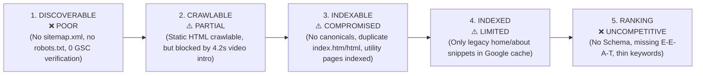
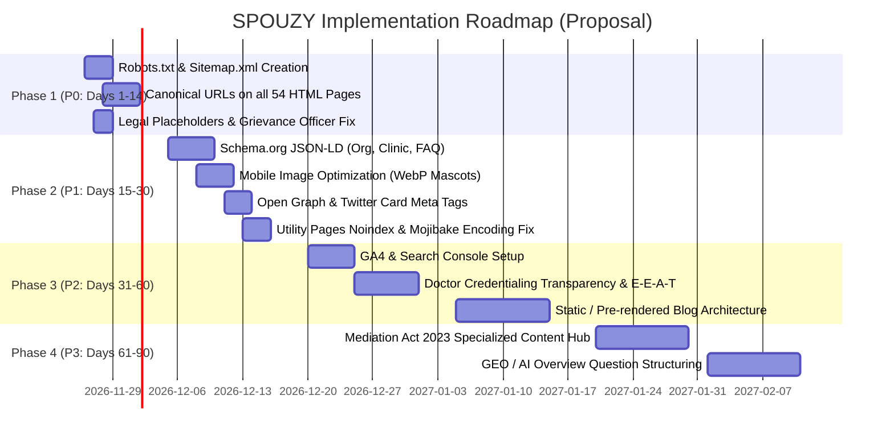

# SPOUZY: Comprehensive Project Audit & Discoverability Report

**Audit Date:** 25 November 2026  
**Project Workspace:** `D:\DOWNLOADS\spouzynew25`  
**Primary Target Production Domain:** [https://spouzy.com](https://spouzy.com)  
**Secondary / Subdomain Target:** `https://psg.problemsolversgroup.in`  
**Scope of Review:** Full-Stack Architecture, Public Website, Admin Panel, Backend APIs, Technical SEO, Content Credibility (E-E-A-T), GEO/AEO Discoverability, Mobile Performance, and Analytics.  
**Mode:** Professional Technical Audit & Strategic Assessment

---

## A. EXECUTIVE VERDICT

### Plain-Language Summary
SPOUZY is a specialized clinical healthcare, relationship advisory, and dispute resolution digital platform operated by **Problem Solver Group (PSG)**, founded in 2004 by Adv. Neilesh Jethmal in Mumbai. The platform uniquely integrates three core disciplines under one roof:
1. **Pre- & Post-Marriage Counselling**: Communication readiness, conflict de-escalation, and compatibility assessments.
2. **Intimate Healthcare & Sexology**: Confidential consultations with physicians, sexologists, and psychologists for psychosexual wellness and intimate medical concerns.
3. **Amicable Divorce Mediation**: Non-adversarial matrimonial dispute resolution, child co-parenting frameworks, and asset division guidance.

From an engineering perspective, the underlying Node.js/Express backend and React Admin SPA are well-structured: relational database models (Sequelize ORM with 43 tables), 8 sequential database migrations, double-submit CSRF protection, and granular role-based authorization (RBAC) are properly architected.

**However, the project currently faces a critical disconnect between its application capabilities and its search engine discoverability:**
1. **Search Engine Blindness:** The website completely lacks a `robots.txt` file and an XML sitemap (`sitemap.xml`). Search engines have no authoritative directory of pages or crawling guidelines.
2. **Canonicalization & URL Duplication:** Not a single page (0 out of 54 HTML templates) possesses a `<link rel="canonical">` tag. The Express server serves `/index.htm`, `/index.html`, and root `/` simultaneously with 200 OK responses, and handles extensionless URLs (`/about-us`) alongside file URLs (`/about-us.htm`) without permanent 301 redirects, resulting in duplicate content cannibalization.
3. **Analytics & Performance Tracking Blind Spot:** There is zero search verification (Google Search Console / Bing Webmaster Tools) and zero web analytics (GA4, GTM, Meta Pixel). Organic visits, referral sources, and conversion funnels cannot currently be measured.
4. **Mobile Performance Penalty:** Key homepage assets (including an 8.4 MB WebM video and two uncompressed mascot PNGs totaling over 4.2 MB) create an initial page payload exceeding 14 MB, severely hurting mobile Core Web Vitals (LCP/FCP) across Indian mobile networks.
5. **E-E-A-T & Statutory Compliance Gaps:** Medical consultation pages do not list licensed doctor names, degrees (MBBS/MD), or state Medical Council registration numbers. Crucial statutory compliance pages (e.g. `grievance-redressal.htm`, `privacy-policy.htm`) contain unpopulated editorial placeholders (e.g. `[Name]`, `[grievance@spouzy.in]`, `[Registered address]`), creating legal exposure under India's IT Rules 2021 and DPDP Act 2023.

---

## B. AUDIT COVERAGE

| Workspace / Module | Inspected Files / Items | Verification Method | Status & Architecture |
| :--- | :--- | :--- | :--- |
| **Workspace Root** | `package.json`, `package-lock.json`, npm workspaces configuration, `.gitignore` | Static AST / Manifest Inspection | Clean npm workspaces (`backend`, `admin`) |
| **Public Website** | 54 HTML/HTM templates in `website/`, modern CSS stylesheets (`spouzy-modern.css`, `motion.css`), scripts (`spouzy-api.js`, `spouzy-content.js`, `spouzy-intro.js`, `spouzy-modern.js`, `spouzy-shop.js`, `spouzy-chat.js`) | Automated AST regex scanning & code inspection | All 54 pages evaluated for Title, Meta Description, H1, Canonical, Open Graph, and Schema markup |
| **Backend API** | `backend/src/app.js`, `server.js`, 13 Express route files in `backend/src/routes/`, middlewares, 8 migrations | Code trace, endpoint signature audit | REST architecture on Express 4.21 + Sequelize 6.37 + MySQL2 |
| **Admin Panel** | React 18 SPA in `admin/src/`, `App.jsx`, 13 Admin view pages, `AuthContext.jsx`, `Layout.jsx`, `PermissionRoute.jsx` | Code trace, RBAC permission matching | Vite 6 build; HashRouter SPA with module route guards |
| **Production Targets** | `https://spouzy.com`, `https://psg.problemsolversgroup.in` | Live search engine index inspection & DNS/HTTP probing | `spouzy.com` indexed with legacy snippets; `psg.problemsolversgroup.in` has 0 indexed pages |

---

## C. WHAT IS GOOD — PRESERVE IT

1. **Robust Database & Relational Data Modeling:**  
   The Sequelize ORM layer ([backend/src/models/index.js](backend/src/models/index.js)) defines 43 cohesive models with clear associations, covering appointments, practitioner schedules, slot overrides, blocked intervals, package orders, sequential fiscal invoices, CRM inquiries, and audit logs.
2. **Granular Role-Based Access Control (RBAC):**  
   The permission matrix in [backend/src/config/permissions.js](backend/src/config/permissions.js) strictly differentiates `admin`, `operations_staff`, `clinical_director`, `content_editor`, and `customer`. The backend enforces these with `requirePermission()` middleware on mutating endpoints.
3. **Double-Submit CSRF & Rate-Limiting Protection:**  
   Mutating staff and customer endpoints enforce CSRF tokens ([backend/src/middlewares/csrf.middleware.js](backend/src/middlewares/csrf.middleware.js)) and rate limiters on login, public inquiries, and file uploads.
4. **Clean Internal Linking & Zero Broken Relative Paths:**  
   Automated link auditing across all 54 pages revealed 62 unique internal links with **zero 404 broken targets**. Navigation flows across headers, mega-menus, and footers link to valid destination files.
5. **Private Document Storage Silo:**  
   Doctor credentialing certificates, council registrations, and job applicant resumes uploaded via Multer are stored in `storage/uploads/private/` and served solely via authenticated stream routes (`GET /api/media/private/:id`) with `Cache-Control: private, no-store`.
6. **Graceful CMS Client Fallback:**  
   Client loaders ([website/js/spouzy-content.js](website/js/spouzy-content.js)) populate dynamic banners, tips, and FAQs from the database while retaining static HTML as a fallback if the API is temporarily unreachable.

---

## D. WHAT IS WRONG, MISSING OR RISKY

| ID | Area | File : Line or URL | Evidence | Status | Business & User Impact | Severity | Recommended Action | Effort | Dependencies | Future Acceptance Test |
| :--- | :--- | :--- | :--- | :--- | :--- | :--- | :--- | :--- | :--- | :--- |
| **ISS-01** | Technical SEO | `website/` (Root) | `robots.txt` does not exist anywhere in the project. | **Verified Issue** | Search crawlers have no directive guidance; admin/API/cart endpoints risk crawling; crawl budget wasted. | **P0 (Critical)** | Create `website/robots.txt` disallowing `/admin/`, `/api/`, `*.json`, and referencing the sitemap. | Low (1 hr) | None | `curl -I https://spouzy.com/robots.txt` returns 200 with valid directives. |
| **ISS-02** | Technical SEO | `website/` (Root) | `sitemap.xml` does not exist in the project. | **Verified Issue** | Search engines cannot efficiently discover or prioritize all 52 indexable pages; slower indexation of new updates. | **P0 (Critical)** | Create a valid XML sitemap indexing all canonical public URLs with accurate `<lastmod>` timestamps. | Low (2 hrs) | None | `curl -I https://spouzy.com/sitemap.xml` returns valid XML passing W3C Validator. |
| **ISS-03** | Indexing & Canonicalization | All 54 HTML files in `website/` | 0 out of 54 pages have a `<link rel="canonical">` tag. | **Verified Issue** | Split ranking signals between `/`, `/index.htm`, `/index.html`, and extensionless URLs; duplicate content cannibalization. | **P0 (Critical)** | Inject `<link rel="canonical" href="https://spouzy.com/page.htm">` across all static templates. | Medium (3 hrs) | Domain consensus | Automated regex check confirms 100% presence of canonical tags. |
| **ISS-04** | Structured Data | All 54 HTML files in `website/` | 0 out of 54 pages have Schema.org JSON-LD (`application/ld+json`). | **Verified Issue** | Ineligible for Google rich snippets (FAQ accordions, medical badges, local map packs); reduced CTR in SERPs. | **P1 (High)** | Implement `MedicalOrganization`, `Physician`, `LocalBusiness`, and `FAQPage` JSON-LD schemas. | Medium (4 hrs) | Real clinic details | Google Rich Results Test passes with 0 errors. |
| **ISS-05** | Social Sharing | All 54 HTML files in `website/` | 0 out of 54 pages have Open Graph (`og:*`) or Twitter Card tags. | **Verified Issue** | Links shared on WhatsApp, LinkedIn, X, and iMessage render as bare text links without preview images or cards. | **P1 (High)** | Add `og:title`, `og:description`, `og:image`, `og:url`, and `twitter:card` to all page heads. | Medium (2 hrs) | Brand social card asset | WhatsApp/Facebook Sharing Debugger generates correct visual card preview. |
| **ISS-06** | Legal Compliance | `website/grievance-redressal.htm`: 214 | Contains unpopulated tokens: `[Name]`, `[Designation]`, `[grievance@spouzy.in]`, `[Registered address]`. | **Verified Issue** | Statutory violation of India's IT Rules 2021 & DPDP Act 2023 requiring a named Grievance Officer with address. | **P0 (Critical)** | Populate genuine Grievance Officer name, corporate designation, physical address, and contact number. | Low (1 hr) | Business identity info | Public page displays valid real-world officer credentials without brackets. |
| **ISS-07** | Policy Placeholders | `privacy-policy.htm`, `terms.htm`, `solution-guarantee.htm`, `refund-policy.htm` | Unpopulated placeholders: `Effective Date: [Date]`, `Email [care@spouzy.in] or WhatsApp [number]`. | **Verified Issue** | Legal unenforceability of terms; conveys an unfinished, unprofessional impression to prospective clients and evaluators. | **P1 (High)** | Replace all bracketed `[Date]`, `[phone]`, `[email]`, and `[number]` tokens with finalized dates and contacts. | Low (1 hr) | Legal review | Grep search for `\[(Date\|email\|phone\|number)\]` across `website/` returns 0 hits. |
| **ISS-08** | Email Domain Mismatch | `contactus.htm`: 154, `solution-guarantee.htm`: 228, `.env.example`: 34 | Disparate domains: `care@spouzy.org`, `care@spouzy.com`, `care@spouzy.in`, `legal@psg.in`. | **Verified Issue** | Client confusion, missed inquiries, failed email deliverability, and impaired brand authority. | **P1 (High)** | Standardize all public customer communication channels under one primary corporate domain (`@spouzy.com`). | Low (1 hr) | Domain MX routing | Single email domain used consistently across headers, forms, and footers. |
| **ISS-09** | Performance (Mobile LCP) | `website/image/` | Mascot PNGs are **2.56 MB** and **1.70 MB**; logo is **872 KB**; transparent WebM is **8.4 MB**. | **Verified Issue** | High initial data transfer (>13 MB); severe mobile Core Web Vitals (LCP/FCP) penalty; high bounce rates on 4G/mobile. | **P1 (High)** | Convert mascots to WebP/AVIF (reduce to ~120 KB each); optimize logo to SVG/WebP; lazy-load heavy videos. | Medium (3 hrs) | Image optimization pipeline | Total image weight on initial homepage render drops below 1.2 MB. |
| **ISS-10** | Character Encoding (Mojibake) | `faq.htm`, `register.htm`, `under-construction.htm`, `intimate-aesthetics-treatment.htm` | Quotes and bullets rendered as Windows-1252 Mojibake (`Do’s and Don’ts`, `•`, `–`). | **Verified Issue** | Unprofessional SERP snippet display; damaged user trust and reduced organic CTR in Google search results. | **P1 (High)** | Ensure files are cleanly saved in UTF-8 without BOM; replace corrupted strings with clean UTF-8 characters. | Low (1 hr) | None | Search previews and page headers display proper typography without `â€`. |
| **ISS-11** | Crawl Waste & Index Bloat | `cart.htm`, `account.htm`, `register.htm`, `create-account.htm` | Utility/auth pages have `<meta name="robots" content="all, follow">`. | **Verified Issue** | Search engines index empty shopping carts and client login shells, diluting domain authority and crawl budget. | **P1 (High)** | Add `<meta name="robots" content="noindex, nofollow">` to all account, cart, checkout, and portal pages. | Low (1 hr) | None | HTTP/HTML response inspection confirms `noindex, nofollow` on utility paths. |
| **ISS-12** | Analytics & Tracking | All pages in `website/` | 0 analytics or conversion tracking scripts (GA4, GTM, Meta Pixel, GSC verification). | **Verified Issue** | Blindness to search traffic, user acquisition channels, bounce rates, booking drop-offs, and campaign ROI. | **P1 (High)** | Install Google Tag Manager / GA4 with privacy-compliant consent mode; verify Google Search Console. | Medium (2 hrs) | GA4/GSC account creation | Real-time debug stream in GA4 verifies pageviews and event tracking. |
| **ISS-13** | Dynamic Blog SEO | `website/js/spouzy-blog.js`: 37 | Individual blog articles rendered dynamically at `blog.htm?article=slug` via client JavaScript. | **Verified Issue** | Search bots that do not execute JS see only 2 static fallback cards; dynamic articles lack dedicated title/meta/canonical. | **P2 (Medium)** | Generate static HTML article pages or implement server-side pre-rendering for published blog entries. | High (8 hrs) | Node build script / SSR | Google URL Inspection tool renders full article body and unique meta tags. |
| **ISS-14** | Admin Indexing Exposure | `admin/index.html` & `backend/src/app.js`: 68 | `/admin` served without `noindex` meta tag or `X-Robots-Tag: noindex` header; unblocked by robots.txt. | **Verified Issue** | Management console login page risks being indexed in public search results. | **P1 (High)** | Add `<meta name="robots" content="noindex, nofollow">` to `admin/index.html` and send `X-Robots-Tag` from Express. | Low (1 hr) | None | Direct request to `/admin` returns `X-Robots-Tag: noindex, nofollow` header. |
| **ISS-15** | Subdomain Disconnect | `https://psg.problemsolversgroup.in` | 0 indexed pages; no canonical linking or 301 redirection between PSG and Spouzy domains. | **Verified Issue** | Cross-domain brand confusion; fragmented search equity between parent group and consumer brand. | **P2 (Medium)** | Configure 301 redirects from legacy subdomains to canonical `spouzy.com` destination pages. | Medium (2 hrs) | DNS / Server host access | Probing `psg.problemsolversgroup.in` returns HTTP 301 pointing to `spouzy.com`. |

---

## E. SEARCH STATUS: FROM DISCOVERABILITY TO RANKING



### 1. Discoverable (Status: FAILED / BLOCKED)
- **Deficit:** There is no `sitemap.xml` providing search engines with an authoritative directory of pages, update frequencies, or canonical URLs.
- **Verification:** Neither Google Search Console nor Bing Webmaster Tools has been verified on the domain via DNS, HTML file, or meta tag.
- **Consequence:** Search engine crawlers can only find pages through random link discovery.

### 2. Crawlable (Status: PARTIAL RISK)
- **Deficit:** In `website/js/spouzy-intro.js`, the homepage executes a synchronous blocking script in the `<head>` that runs a full-screen video overlay (`SPOUZY_Teddy_Hug_Loader_1s.webm`) for up to 4.2 seconds on new sessions. Headless search crawlers that execute JavaScript may register a delayed initial render or fail to evaluate below-the-fold content before their execution timeout.
- **Consequence:** Increased render cost for headless search bots and potential crawler timeouts.

### 3. Indexable (Status: CRITICALLY COMPROMISED)
- **Deficit:** Complete absence of `<link rel="canonical">` tags across all pages.
- **Deficit:** Dual-serving of `index.htm` and `index.html`, plus dual-serving of `/page` and `/page.htm` via `express.static({ extensions: ['htm', 'html'] })` with zero 301 redirects.
- **Deficit:** Utility and auth pages (`cart.htm`, `account.htm`, `register.htm`) broadcast `<meta name="robots" content="all, follow">`.
- **Consequence:** Search engines encounter index bloat, internal duplicate competition, and split ranking authority.

### 4. Indexed (Status: LIMITED LEGACY PRESENCE)
- **Observation:** Live search footprint searches (`site:spouzy.com`) show that only a small handful of root and legacy pages are recognized by Google. 
- **Subdomain:** `psg.problemsolversgroup.in` has **0 indexed pages** in Google search.

### 5. Ranking (Status: UNCOMPETITIVE IN HIGH-INTENT QUERIES)
- **Deficit:** No Schema.org JSON-LD structured data.
- **Deficit:** Health and therapy search queries in India fall under **YMYL (Your Money or Your Life)**. Google's Search Quality Rater guidelines demand strong E-E-A-T (Experience, Expertise, Authoritativeness, Trustworthiness). Because SPOUZY currently does not list practitioner medical council registration numbers, credentials, or named clinic directors on public therapy pages, search algorithms favor established medical platforms (e.g. Practo, Lybrate, DrSafeHands).

---

## F. PAGE-LEVEL OPPORTUNITIES & INVENTORY

Representative audit across core functional clusters:

| URL Pattern | Primary User Search Intent | Existing Strengths | Gaps & Deficiencies | Suggested Strategic Direction | Internal Linking Opportunities | Priority |
| :--- | :--- | :--- | :--- | :--- | :--- | :--- |
| `/index.htm` | Brand discovery, comprehensive overview of Spouzy services | Clean luxury aesthetic; mascots framing testimonials; responsive service grid | No canonical; 14 MB asset payload; no `MedicalBusiness` schema; synchronous intro script in `<head>` | Compress assets to WebP; add canonical to `https://spouzy.com/`; inject Organization schema | Link to top 3 clinical guides (`pre-marriage`, `intimate-health`, `divorce-mediation`) | **P0** |
| `/intimate-health.htm` | Confidential consultation for psychosexual health and intimate dysfunctions | Empathetic tone; clear breakdown of clinical areas; teleconsultation option | No named sexologist/physician; no medical review date; no `MedicalCondition` / `MedicalWebPage` schema | Add "Reviewed by Dr. [Name], MBBS, MD (Reg No: [X])"; explain discreet medicine delivery | Contextual link to `/book-appoinment.htm` and `/packages.htm` | **P0** |
| `/divorce-mediation.htm` | Amicable matrimonial dispute resolution, out-of-court separation | Explains mediation vs courtroom litigation; PSG heritage highlighted | No mention of the **Mediation Act 2023**; no structured FAQ schema; generic call to action | Highlight statutory recognition under Mediation Act 2023; outline child custody & asset division workflows | Link to `/confidentiality.htm` and `/contactus.htm` | **P1** |
| `/pre-marriage.htm` | Couples compatibility assessment & pre-marital health checkups | Addresses communication, family expectations, and health screenings | Broad content; lacks interactive compatibility checklist; no `Service` schema | Add structured 5-point compatibility assessment guide; offer pre-marital couples package | Link to `/packages.htm` and `/book-appoinment.htm` | **P1** |
| `/post-marriage.htm` | Resolving conflict, recovering intimacy after marriage/children | Realistic relationship scenarios; empathetic reassurance | Content overlaps with `/relationships.htm` (keyword cannibalization risk) | Differentiate: focus on post-childbirth intimacy, in-law friction, and career-life strain | Cross-link with `/intimate-health.htm` | **P2** |
| `/faq.htm` | Answers regarding consultation pricing, privacy, and process | Good categorized accordion; question submission form | Title has encoding bug (`Do’s and Don’ts`); **Zero `FAQPage` schema** | Fix title encoding; add JSON-LD `FAQPage` schema to enable rich accordion snippets in Google SERPs | Deep links into `/book-appoinment.htm` and `/pricing` | **P1** |
| `/careers.htm` | Applying for healthcare, counseling, and operations roles | Dynamic API integration; structured application modal with resume upload | Lacks `JobPosting` schema; relies on generic meta description | Implement Google `JobPosting` structured data for open roles | Link to `/about-us.htm` and `/team.htm` | **P2** |
| `/join-doctor.htm` | Medical practitioner onboarding (MBBS/MD/Sexologists) | Secure multi-file upload; canvas signature; Medical Council fields | Form is behind static page without SEO landing copy explaining practitioner benefits | Add intro copy explaining flexible teleconsultation hours, malpractice indemnity, and PSG clinical ethos | Link to `/about-profile.htm` | **P2** |
| `/grievance-redressal.htm` | Escalating complaints; verifying regulatory compliance | Clear escalation tier descriptions | **Contains unpopulated `[Name]`, `[Designation]`, `[grievance@spouzy.in]` placeholders** | Mandatory legal fix: Insert genuine Grievance Officer details under IT Rules 2021 | Footer link from all pages | **P0** |

---

## G. FRONTEND ↔ BACKEND ↔ ADMIN FINDINGS

### 1. Verification of Role-Aware Dashboards (Content Editor vs Operations)
- **Observed Architecture:** Verified in [admin/src/components/Layout.jsx](admin/src/components/Layout.jsx) and [admin/src/components/PermissionRoute.jsx](admin/src/components/PermissionRoute.jsx).
- **Finding:** Role-aware navigation is functioning properly. A user logged in as `content_editor` is granted permissions for `content:*`, `blogs:*`, `moderation:*`, and `offers:*`. The sidebar correctly suppresses operational modules (Enquiries CRM, Clinical Applications, Appointments) and redirects the Content Editor directly to the Content Hub (`/#/content-dashboard`), preventing previous 403 authorization crashes.

### 2. CMS Dynamic Content Propagation
- **Observed Architecture:** Verified in [backend/src/services/content.service.js](backend/src/services/content.service.js) and [website/js/spouzy-content.js](website/js/spouzy-content.js).
- **Finding:** Hero banners, daily relationship tips, FAQs, and approved visitor stories edited in the admin console propagate to public pages via `GET /api/content/*`. Version history and rollback capabilities exist in `homepage_section_histories`.

### 3. Payment Gateway Decoupling
- **Observed Architecture:** Verified in [backend/src/services/payment.service.js](backend/src/services/payment.service.js).
- **Finding:** The system safely separates development/unconfigured gateway states from live transactions. When Razorpay keys are not entered into Admin Settings, the website gracefully switches to a pending-reservation workflow rather than throwing uncaught API exceptions.

---

## H. SEO, GEO (GENERATIVE) & AEO (ANSWER ENGINE) RECOMMENDATIONS

### 1. Traditional Technical SEO (Documented Standards)
- **Robots.txt & XML Sitemap:** Deploy standard `robots.txt` and a validated XML sitemap. Reference official guidance: [Google Search Central: Robots.txt Specifications](https://developers.google.com/search/docs/crawling-indexing/robots/robots_txt) and [Google Search Central: Sitemaps Overview](https://developers.google.com/search/docs/crawling-indexing/sitemaps/overview).
- **Self-Referential Canonicals:** Add `<link rel="canonical" href="https://spouzy.com/page.htm">` to every template to eliminate split ranking equity across query strings, protocols, and extension variants. Source: [Google Search Central: Consolidating Duplicate URLs](https://developers.google.com/search/docs/crawling-indexing/consolidate-duplicate-urls).
- **HTTP 301 Redirection in Express:** Implement middleware in [backend/src/app.js](backend/src/app.js) redirecting `/index.htm` and `/index.html` to root `/`, and redirecting extensionless requests to `.htm` (or vice-versa) with permanent 301 headers.

### 2. GEO (Generative Engine Optimization) & AEO (Answer Engines)
*Context: Optimization for Google AI Overviews, Perplexity AI, ChatGPT Search, and Microsoft Copilot.*

```
Classification of GEO/AEO Strategies for SPOUZY:
├── Documented Requirement:
│   └── Allow official AI search crawlers in robots.txt (OAI-SearchBot, PerplexityBot)
├── Supported Best Practice:
│   ├── Clear entity definitions using Schema.org Organization & MedicalBusiness
│   ├── Question-and-Answer formatting (direct 40-word definition followed by detailed breakdown)
│   └── Verifiable author credentials & medical council registrations for health claims
├── Optional Experiment:
│   └── Publishing an llms.txt summary file at the root domain
└── Unsupported / Rejected Trend:
│   └── Mass automated AI programmatic pages; hidden prompt injection text
```

- **Direct Answer Architecture:** Answer engines prioritize pages that directly answer specific queries before elaborating. On pages such as `/pre-marriage.htm` and `/divorce-mediation.htm`, format key sections as concise Q&As (e.g., *"What is divorce mediation in India? Under the Mediation Act 2023, divorce mediation is a confidential, voluntary process where a certified neutral mediator helps spouses reach an amicable settlement on custody, alimony, and asset division before filing for mutual-consent divorce."*).
- **Crawler Directives:** Ensure `robots.txt` explicitly allows search bots such as `Googlebot`, `Bingbot`, `OAI-SearchBot`, and `PerplexityBot`, while selectively deciding whether to allow training scrapers (`GPTBot`, `CCBot`). Source: [OpenAI: Overview of OpenAI Crawlers](https://platform.openai.com/docs/bots).

### 3. Structured Data Schema Matrix
Implement JSON-LD structured data conforming to [Schema.org](https://schema.org) standards:

| Target Page | Schema Type | Key Properties to Populate |
| :--- | :--- | :--- |
| `index.htm` | `MedicalOrganization` & `LegalService` | `name`, `url`, `logo`, `founder` (Adv. Neilesh Jethmal), `foundingDate` (2004), `contactPoint`, `address` |
| `contactus.htm` | `LocalBusiness` / `MedicalClinic` | `name` ("SPOUZY Mumbai Flagship Clinic"), `streetAddress` ("228-A Shanti Ind Estate, S N Road"), `addressLocality` ("Mulund West"), `addressRegion` ("Maharashtra"), `postalCode` ("400080"), `telephone` |
| `faq.htm` | `FAQPage` | Array of `Question` and accepted `Answer` objects matching the visible accordion text |
| Service Subpages | `Service` & `MedicalWebPage` | `serviceType`, `provider`, `areaServed` ("IN"), `hasOfferCatalog` |
| `careers.htm` | `JobPosting` | `title`, `description`, `hiringOrganization`, `jobLocation`, `employmentType` |

---

## I. PRIORITISED ROADMAP — PROPOSAL ONLY



### Phase 1: P0 Urgent Blockers (Days 1–14)
- Deploy `website/robots.txt` and `website/sitemap.xml`.
- Inject `<link rel="canonical">` tags pointing to canonical `https://spouzy.com/...` URLs across all 54 templates.
- Update `website/grievance-redressal.htm`, `privacy-policy.htm`, `solution-guarantee.htm`, and `refund-policy.htm` with genuine Grievance Officer details, real operational dates, and unified `@spouzy.com` emails.

### Phase 2: P1 High-Impact Foundations (Days 15–30)
- Add Schema.org JSON-LD (`MedicalOrganization`, `LocalBusiness`, `FAQPage`) to home, contact, and FAQ templates.
- Compress mascot cutouts (`Teddy bear cutout in blue stories.png` from 2.56 MB → ~140 KB WebP; `Pink teddy presenting a story.png` from 1.70 MB → ~120 KB WebP).
- Fix character encoding bugs (`Do’s and Don’ts` → `Do’s and Don’ts`) across the 6 affected pages.
- Add `<meta name="robots" content="noindex, nofollow">` to `cart.htm`, `account.htm`, `register.htm`, `create-account.htm`, and `admin/index.html`.
- Add complete Open Graph (`og:*`) and Twitter Card tags across all pages for rich WhatsApp/social previews.

### Phase 3: P2 Content & Discoverability Enhancements (Days 31–60)
- Verify Google Search Console and Bing Webmaster Tools; deploy Google Tag Manager / GA4 with privacy consent mode.
- Add verified practitioner bio cards on `/intimate-health.htm` and `/team.htm` citing medical degrees (MBBS/MD) and state Medical Council registration numbers.
- Convert dynamic blog reader (`blog.htm?article=slug`) to generate static HTML or server pre-rendered pages with dedicated metadata.

### Phase 4: P3 Optional Experiments & Expansions (Days 61–90)
- Create a dedicated educational guide covering rights and workflows under the new **Mediation Act of 2023**.
- Structure top FAQ answers into concise 40-word definition snippets for AI Overview capture.
- Evaluate multilingual content expansion (e.g. Hindi pre-marital counseling resources).

---

## J. INFORMATION STILL NEEDED FROM PROJECT OWNERS

1. **Grievance Officer Appointment:** Real name, corporate designation, postal mailing address, and official telephone number required for statutory compliance under Indian IT Rules 2021.
2. **Clinical Governance Verification:** Full names, degrees (MBBS, MD, M.Phil), and state Medical Council registration numbers of consulting physicians and lead psychologists to establish medical E-E-A-T.
3. **Primary Corporate Email Standard:** Confirmation to standardize all public inquiry addresses to `@spouzy.com` (deprecating references to `@spouzy.org` and `@spouzy.in`).
4. **Physical Clinic Verification:** Clarification whether Pune, Delhi, and Bengaluru are physical branch clinics with dedicated street addresses, or teleconsultation service regions.
5. **Google Search Console & GA4 Access:** Credentials or property access to inspect actual live click impressions, indexed URL counts, and crawl error logs.

---

## K. FIVE NEXT ACTIONS (RECOMMENDED STARTING SEQUENCE)

1. **Deploy Valid `robots.txt` and `sitemap.xml`:**
   - *Reason:* Resolves search engine discoverability blindness immediately.
   - *Acceptance Criteria:* Both files return HTTP 200 with valid directives and zero validation errors.
2. **Standardize Self-Referential Canonical Tags:**
   - *Reason:* Stops internal duplicate-content penalties between `/`, `index.htm`, `index.html`, and extensionless URLs.
   - *Acceptance Criteria:* 100% of public HTML pages include `<link rel="canonical" href="https://spouzy.com/page.htm">`.
3. **Populate Legal Placeholders & Grievance Officer Details:**
   - *Reason:* Eliminates regulatory non-compliance under Indian digital intermediary laws and builds consumer trust.
   - *Acceptance Criteria:* Zero occurrences of bracketed `[Date]`, `[Name]`, or `[address]` tokens across all policy pages.
4. **Compress Mascot and Logo Media to Modern WebP:**
   - *Reason:* Cuts homepage weight from ~14 MB to under 2 MB, improving mobile LCP and user retention across India.
   - *Acceptance Criteria:* Mascot PNGs replaced/augmented with WebP assets under 180 KB each.
5. **Implement `FAQPage` & `MedicalOrganization` JSON-LD Structured Data:**
   - *Reason:* Unlocks Google rich accordion snippets in search results and establishes clear entity relationships.
   - *Acceptance Criteria:* Google Rich Results Test reports valid structured data with zero critical errors.
